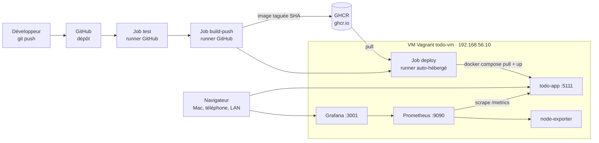

# Projet DevOps : Vagrant · Docker · GitHub Actions · Prometheus · Grafana

Ce projet déploie une application **Todo List** (Node.js / Express + React, base SQLite) :
- dans une **VM Vagrant** (VirtualBox, Ubuntu 22.04) provisionnée avec Docker ;
- en **conteneur Docker**, exposé par adresse IP ;
- avec une **CI/CD GitHub Actions** : chaque `git push` sur `main` teste, construit et publie l'image, puis met à jour le conteneur de la VM automatiquement ;
- avec **Prometheus et Grafana** pour l'observabilité.

---

## 1. Architecture



| Composant | Rôle | Port |
|---|---|---|
| `todo-app` | Application (image `ghcr.io/pettanggrace/mon-projet-vagrant/todo-app`) | 5111 |
| `prometheus` | Collecte des métriques toutes les 15 s, rétention 7 jours | 9090 |
| `grafana` | Dashboard « Todo App - Observabilité », provisionné automatiquement | 3001 |
| `node-exporter` | Métriques système de la VM (CPU, RAM, disque) | interne |
| Runner GitHub `todo-vm` | Exécute le job de déploiement dans la VM | — |

---

## 2. Structure du dépôt

```
mon-projet-vagrant/
├── Vagrantfile                  # VM VirtualBox : IP privée, ports redirigés, 3 Go RAM
├── provision.sh                 # Installation de Docker Engine + Docker Compose
├── compose.prod.yaml            # Pile de production : app + Prometheus + Grafana + node-exporter
├── .github/workflows/ci-cd.yml  # Pipeline CI/CD
├── monitoring/
│   ├── prometheus/prometheus.yml
│   └── grafana/
│       ├── provisioning/        # Source de données + chargement des dashboards
│       └── dashboards/todo-app.json
└── todo-list-app/
    ├── Dockerfile               # Image multi-stage, utilisateur non-root, HEALTHCHECK
    ├── src/metrics.js           # Endpoint /metrics (prom-client)
    └── spec/                    # Tests Jest
```

---

## 3. Démarrage

### Prérequis
VirtualBox 7, Vagrant, Git, et un Mac Intel / PC x86_64 avec au moins 8 Go de RAM.

### Lancer la VM
```bash
git clone git@github.com:pettanggrace/mon-projet-vagrant.git
cd mon-projet-vagrant
vagrant up            # crée la VM et installe Docker (provision.sh)
```

### Installer le runner GitHub (une seule fois par VM)
Dans GitHub : *Settings → Actions → Runners → New self-hosted runner* (Linux x64). Puis dans la VM :
```bash
vagrant ssh
mkdir -p ~/actions-runner && cd ~/actions-runner
# commandes "Download" (curl + tar) copiées depuis la page GitHub
./config.sh --url https://github.com/pettanggrace/mon-projet-vagrant \
  --token <TOKEN> --name todo-vm --labels todo-vm --unattended
sudo ./svc.sh install vagrant && sudo ./svc.sh start
```

### Premier déploiement
Faire un `git push` sur `main`, ou lancer le workflow à la main (*Actions → CI/CD todo-app → Run workflow*).

---

## 4. Accès (infrastructure ouverte)

| Service | Depuis le Mac (IP privée) | Depuis le réseau local |
|---|---|---|
| Application | http://192.168.56.10:5111 | http://IP-DU-MAC:5111 |
| Métriques de l'app | http://192.168.56.10:5111/metrics | http://IP-DU-MAC:5111/metrics |
| Prometheus | http://192.168.56.10:9090 | http://IP-DU-MAC:9090 |
| Grafana (`admin` / `admin`) | http://192.168.56.10:3001 | http://IP-DU-MAC:3001 |

Les ports sont redirigés sur `0.0.0.0` du Mac par le `Vagrantfile`, ce qui rend les services accessibles à tout appareil du même réseau. L'IP du Mac s'obtient avec `ipconfig getifaddr en0`.

---

## 5. Pipeline CI/CD

Le pipeline se déclenche à **chaque push sur `main`**, que la modification porte sur le code, les scripts ou la configuration. On peut aussi le lancer à la main.

| Job | Exécuté sur | Actions |
|---|---|---|
| **test** | `ubuntu-latest` (GitHub) | Syntaxe de `provision.sh`, validation de `compose.prod.yaml`, tests Jest |
| **build-push** | `ubuntu-latest` (GitHub) | Build de l'image Docker, push sur GHCR avec les tags `latest` et `<sha du commit>` |
| **deploy** | runner auto-hébergé `todo-vm` | `docker compose pull`, puis `up -d`, puis vérification du healthcheck, de Prometheus et de Grafana |

**Pourquoi un runner auto-hébergé ?** La VM est sur un réseau privé : les serveurs de GitHub ne peuvent pas la joindre. Le runner installé dans la VM se connecte lui-même à GitHub et exécute le déploiement en local.

**Sécurité (dépôt public)** : le workflow n'a pas de déclencheur `pull_request`, donc le code d'un fork ne peut jamais s'exécuter sur la VM. L'authentification à GHCR utilise le `GITHUB_TOKEN` éphémère : aucun secret n'est stocké.

**Traçabilité** : `docker ps` dans la VM affiche le SHA du commit déployé, par exemple `todo-app:a167a94…`.

---

## 6. Observabilité

**Métriques exposées par l'app** (`/metrics`) :

| Métrique | Type | Description |
|---|---|---|
| `http_requests_total{method,route,status}` | Counter | Nombre de requêtes HTTP |
| `http_request_duration_seconds` | Histogram | Latence (p50 / p95) |
| `todo_items{status}` | Gauge | Nombre de tâches en cours ou terminées (métrique métier) |
| `process_*`, `nodejs_*` | Divers | CPU, mémoire, event loop du process Node.js |

**Dashboard Grafana** « Todo App - Observabilité » : cibles UP, tâches, débit par route, taux d'erreurs 5xx, latence, mémoire Node.js, et CPU, RAM et disque de la VM. La source de données et le dashboard sont **provisionnés sous forme de code** depuis `monitoring/grafana/`.

Pour générer du trafic de test :
```bash
for i in $(seq 1 200); do curl -s http://192.168.56.10:5111/items >/dev/null; done
```

---

## 7. Commandes utiles et dépannage

```bash
vagrant ssh -c "docker ps"                                    # état des conteneurs
vagrant ssh -c "docker logs --tail 50 todo-app"               # logs de l'application
vagrant ssh -c "sudo journalctl -u 'actions.runner.*' -n 20"  # logs du runner
```

| Problème | Solution |
|---|---|
| Job « deploy » bloqué en *Queued* (souvent après une mise en veille du Mac) | `vagrant ssh -c "cd ~/actions-runner && sudo ./svc.sh stop && sudo ./svc.sh start"` |
| Runner *Offline* | Vérifier que la VM tourne (`vagrant status`, puis `vagrant up`) |
| Après `vagrant destroy` | Le runner est perdu : le supprimer dans *Settings → Runners*, puis le réinstaller (section 3) |
| Les données des tâches | Elles sont conservées dans le volume Docker `todo_todo-data`, même entre deux déploiements |
